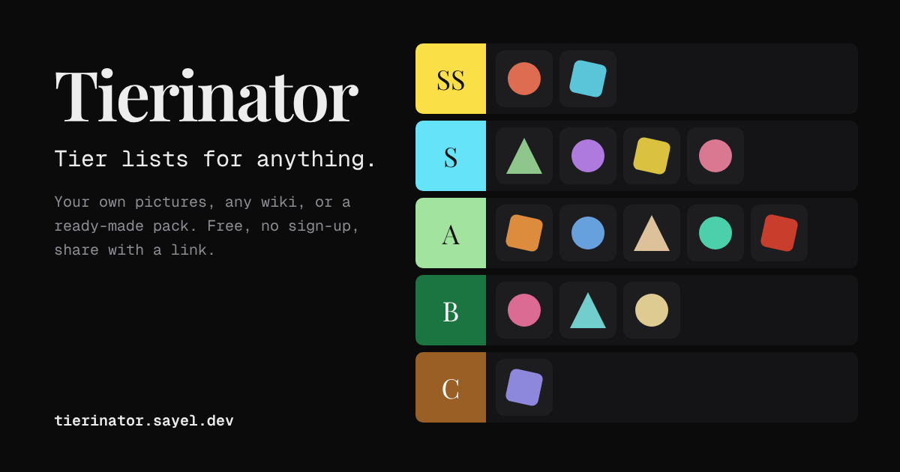

# Tierinator

Tier lists for anything: your own pictures, characters from any wiki, or a ready-made pack.

**[tierinator.sayel.dev](https://tierinator.sayel.dev)**. Free, with no account. Your lists stay in your browser.



## What it does

- **Anything:** upload or paste pictures, type a list, open a CSV, search the web, or pull a whole category from a wiki.
- **Templates:** a gallery of ready-made lists (planets, dog breeds, flags…) to rank yourself, each with its own page
  at `/t/<id>/` for search engines; anyone can suggest one or add it by pull request ([docs/templates.md](docs/templates.md)).
- **Packs:** ready-made sets that load when you open them. The Pokémon pack has all 1,025 species and their forms, with
  every sprite style from every game (animated ones too), GO icons and Mystery Dungeon portraits.
- **Ranking that keeps up:** drag, box-select, or the keyboard alone (arrows, Space, number keys); Quick rank (one at a
  time) and head-to-head.
- **Stream mode:** rank live on video. Only the tiers, big, and the item being ranked; number keys or a drag to place
  it, undo, a green or magenta screen for chroma key, and controls you can hide so they stay off camera.
- **Charts as well as tiers:** lay a list out as a grid of labelled cells instead of rows, such as the 3 × 3 alignment
  chart (lawful good to chaotic evil).
- **Your look:** one dark theme to start from, and every font, colour and size in it yours to change. Export as PNG, SVG or PDF, or the list as a CSV.
- **Share with a link:** the list travels inside the link; whoever opens it can keep a copy.
- **Credits kept:** pictures from Wikipedia keep their author and licence, shown with the item and in one list.
- **Install it, use it offline:** add it to your home screen or desktop; after one visit it opens without a connection.
- **Rank as a group:** friends rank the same list and send their links or list files; Combine rankings makes the
  group's list and shows what everyone agreed and disagreed on.

Every feature, with where to find it: [docs/features.md](docs/features.md).

## Run it

You need [Node.js](https://nodejs.org) 22+ and [pnpm](https://pnpm.io).

```sh
pnpm install
pnpm dev            # http://localhost:5173
```

| Command | Does |
| --- | --- |
| `pnpm dev` | Development server, reloads as you edit |
| `pnpm verify` | Lint, types, dead-code check, unit tests and build. Run before pushing |
| `pnpm test:e2e` | Browser tests at desktop and phone sizes, under the real security headers |
| `pnpm format` | Fix formatting and import order |
| `pnpm build` / `pnpm preview` | The finished site in `dist/`, and a local server for it |

## Host your own copy

It's a static site: any host that can serve files and set headers works. The setup used here (Cloudflare Workers,
deployed from GitHub Actions only when every check passes) is in [docs/hosting.md](docs/hosting.md), including which
names to change for your own domain.

## How it's built

TypeScript, Vite and plain CSS, with no UI framework; Biome, Knip, Vitest and Playwright to keep it honest. Two runtime
dependencies: `fflate` (zips) and `jsPDF` (PDF export).

| | |
| --- | --- |
| [docs/features.md](docs/features.md) | Every feature, where to find it, its shortcut, and the limits |
| [docs/architecture.md](docs/architecture.md) | How the code is organised and the rules between its parts |
| [docs/decisions.md](docs/decisions.md) | Every tool choice, what it was compared with, and why |
| [docs/security.md](docs/security.md) | What could go wrong, and what stops it |
| [docs/hosting.md](docs/hosting.md) | GitHub, Cloudflare and domain settings, and why each one |
| [docs/templates.md](docs/templates.md) | Ready-made templates: the file format, the rules, and adding one by pull request |
| [docs/defence.md](docs/defence.md) | Every part's design argued: how it works, why not the alternative, what if, where it fails |
| [CONTRIBUTING.md](CONTRIBUTING.md) | How to help |

## Credits

Pokémon data and sprites: [PokeAPI](https://pokeapi.co). Animated sprites: the Smogon community, via Pokémon Showdown.
Pokémon GO icons: [PokeMiners](https://github.com/PokeMiners/pogo_assets). Mystery Dungeon portraits:
[PMDCollab](https://github.com/PMDCollab/SpriteCollab). Sprites load from those collections when shown; none are stored
here.

Pokémon and all related names and images are trademarks and © of Nintendo, Creatures, GAME FREAK and The Pokémon
Company. Tierinator is an unofficial fan project, not affiliated with or endorsed by them.

## Licence

[MIT](LICENSE). The bundled fonts (Playfair Display, Instrument Sans, Geist Mono) are under the SIL Open Font License;
see [NOTICE](NOTICE) for that and for Pokémon names and images.
